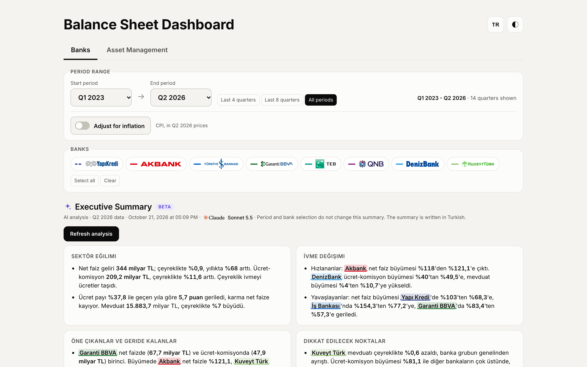
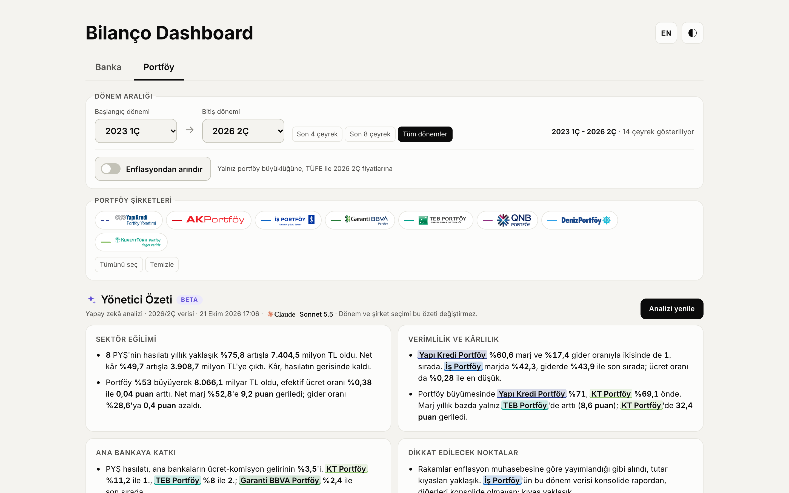
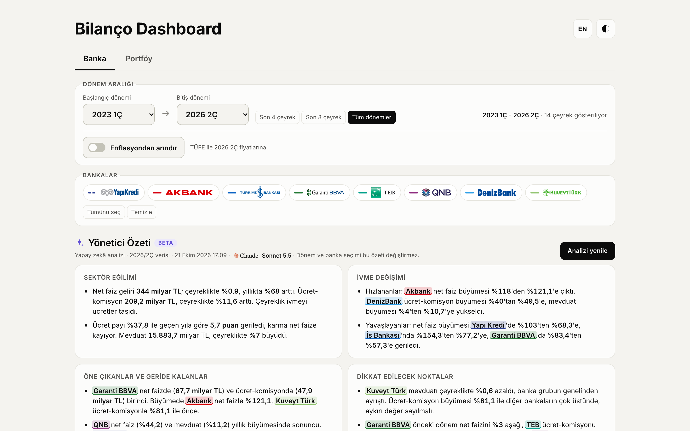

# Balance Sheet Dashboard

**Live:** https://bilanco-dashboard-production.up.railway.app

A dashboard that compares the quarterly financials of 8 major Turkish banks (Akbank, İşbank, Garanti BBVA, Yapı Kredi,
TEB, QNB, DenizBank, Kuveyt Türk) and their asset management companies on a single page.
Q1 2023 to Q2 2026, in Turkish and English.



## What I built

- **PDF data pipeline:** Python scripts that extract figures from 160+ regulatory filings (income statements, balance sheets,
  asset manager reports) by their official line codes. Every value is stored with its page number, and reconciliation and
  chain checks catch bad extractions.
- **Executive summary agent:** Facts are computed from the data, an LLM (Claude via OpenRouter) writes the summary using only
  those facts, and every number in the text is then checked against them. If a number does not match, the model gets one
  correction round; if it still fails, the summary is not published.
- **Inflation adjustment:** A switch that restates bank figures to last quarter prices with the Turkish CPI
  (flows use the quarterly average index, stocks use the quarter end index).
- **Assets under management:** Monthly AUM from the Capital Markets Board (SPK) archive and API, plus an effective fee rate
  (annual revenue over average AUM).
- **Bilingual interface:** TR/EN switch without reload, localized number and period formats, light and dark themes, mobile layout.
- **Deployment:** Dependency free Node server on Railway with a persistent volume; a single file HTML build is also available.

**Sources:** BRSA (BDDK) consolidated reports and investor presentations of the banks, asset manager reports (KAP),
monthly AUM data from SPK, CPI from the Central Bank of Turkey. Source PDFs are not in the repo; extracted raw rows are under `veri/`.

**Stack:** Python (pdftotext, xlrd), Node.js, vanilla JS, ECharts, OpenRouter, Railway.

<p>
  
  
</p>

---

Technical notes below. File, folder and function names are in Turkish.

## Structure

```
kaynak/        -> source PDF folder (symlink, read only, not in git)
betikler/      Python extraction and build scripts
  ortak.py                 bank list, paths, number parsing
  cikar_gelir_tablosu.py   income statement PDF -> veri/ham/<bank>/<period>.json
  cikar_bilanco.py         deposits from the balance sheet
  cikar_pys.py             asset manager reports
  cikar_spk_buyukluk.py    AUM from SPK
  kontrol.py               reconciliation and chain checks (exit 0 = passed)
  panel_olustur.py         quarterly panel -> veri/panel.csv + web/data/panel.json
  tek_dosya.py             single file HTML build
veri/
  ham*/                    extracted rows per report, with page numbers
  panel.csv                bank × period × item, thousand TL
  notlar.md                check results and cross checks against presentations
analiz/        executive summary agent (facts, prompt, number verification, tests)
web/           static site (index.html, app.js, style.css, data/)
server.js      dependency free static server (PORT env)
```

## Refreshing the data

Add the new report as `kaynak/Banka Konsolide Raporlar/<NN_Bank>/<YYYY>_<Q>C_*.pdf`,
extend the `DONEMLER` list in `betikler/ortak.py`, then:

```bash
npm run veri       # extract + check + build panel (+ summaries if figures changed)
npm run buyukluk   # AUM from SPK (uv + xlrd)
npm start          # http://localhost:3000
npm test
```

Requirements: `pdftotext` (poppler), Python 3, Node 18+, `uv` for the AUM script.

## Method

- Lines are located by BRSA line codes (I, II, III, IV, 4.1, 4.1.1, 4.1.2, 4.2); some PDFs do not yield label text.
- Reports are year to date; quarterly = difference of cumulative values. 2023 quarters come from the prior period column of 2024 reports.
- In 4 column interim tables the column order differs by bank (`SIRA_A`); `kontrol.py` verifies it by comparing the quarterly column with the cumulative difference.
- Q2 2026 reports are in million TL; the unit is read from the document and converted to thousand TL.
- Amounts are nominal. The inflation switch restates bank amounts to last quarter prices with CPI
  (income items with the quarterly average index, deposits with the quarter end index, `veri/tufe.csv`). Ratios are unchanged.

## Investment services share of net fees

`veri/uvek_yatirim_payi.csv` is read manually from the net fee and commission charts in investor presentations
(Akbank, Garanti BBVA and recent İşbank presentations are images). Scope: Akbank Wealth Management, İş Asset Management,
Garanti Brokerage + AM, Yapı Kredi Investment Products. QNB and TEB do not show this slice; Kuveyt Türk and DenizBank
have no quarterly presentation.

## Deposits

`betikler/cikar_bilanco.py` extracts the "I. MEVDUAT" line from the liabilities side of the consolidated balance sheet
(Kuveyt Türk: "TOPLANAN FONLAR", from Q2 2026 "KATILIM FONU") as TL, FX and total -> `veri/ham_bilanco/`, `veri/mevduat.csv`.
`kontrol.py` also checks TL + FX = total and that the prior year end column matches last year's Q4 report.

## Asset management tab

`betikler/cikar_pys.py` extracts revenue, general administrative and marketing expenses and net profit from the solo reports
of the asset managers -> `veri/ham_pys/`, `veri/pys_panel.csv`. Reports without extractable text (5 scanned Deniz Portföy reports)
and the split label in Ak Portföy Q3 2024 are kept in `veri/pys_elle.json` as manually read values with source notes.
Asset managers apply IAS 29; figures are used as published, without inflation adjustment.
Quarter: Q1 from the report, Q2 and Q3 from the 3 month column, Q4 = annual minus 9 months.

## Assets under management (SPK)

`npm run buyukluk` pulls monthly AUM for quarter ends -> `veri/pys_buyukluk.csv`, raw files in `veri/ham_spk/`.
Up to September 2024 from the yearly .xls files on the SPK site, after that from the SPK API.

## Language and "What's New" dialog

`web/app.js`: English for static text is in the `EN_METIN` dictionary, generated text uses `L(tr, en)`. Switch with `?lang=en`
or the EN/TR button. For a new release, change `YENILIK_SURUM` and update the `YENILIKLER` items; the dialog opens once per browser.

## Executive summary agent

Design: `docs/superpowers/specs/2026-10-15-banka-analiz-agent-design.md` (Turkish).
`analiz/olgular.js` computes facts from the data, `analiz/agent.js` asks the model for a summary through OpenRouter,
`analiz/dogrula.js` checks that every number comes from the facts (one correction round on failure; if it still fails,
the previous summary is kept and the error goes to `veri/analiz_hata.log`).
- At the end of `npm run veri` each summary (bank, asset management) is regenerated only if its own figures changed;
  `npm run analiz` regenerates both.
- Key: `OPENROUTER_API_KEY` from a local env file outside the repo, or an environment variable on Railway.
  Optional `OPENROUTER_MODEL` (default `anthropic/claude-sonnet-5.5`). One run costs roughly 0.10 to 0.20 USD.
- Server: `POST /api/analiz` (at most once per 10 minutes), `GET /api/analiz` for status.
- One off events maintained by hand: `veri/olaylar.json`.

## Feedback on summaries

Each summary has "Useful / Needs work" buttons and a comment field. Feedback is collected only, never applied automatically:
stored in `veri/geri_bildirim.jsonl` (not in git).

## Deployment (Railway)

Railway detects Node from `package.json` and runs `npm start`; `PORT` comes from Railway. The site needs only `web/` and
`server.js`. For static hosting (Netlify etc.) the publish directory is `web/`.
